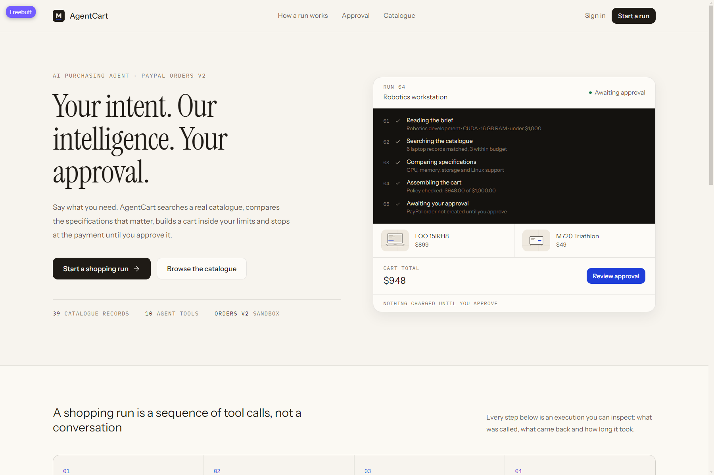
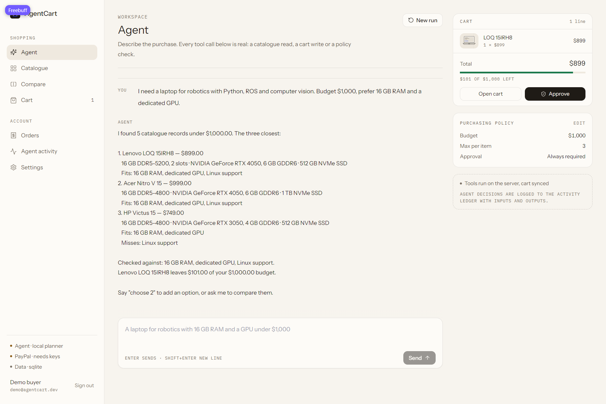

# AgentCart

**Your intent. Our intelligence. Your approval.**

AgentCart is an AI purchasing agent built for the PayPal AI Hackathon 2026. You describe what you need. The agent
searches a real product catalogue, compares the specifications that matter, explains its choice, builds a cart inside
your purchasing policy and prepares an approval sheet. It cannot pay. You approve the order and pay in PayPal sandbox.





Documentation: [architecture](docs/ARCHITECTURE.md) · [API](docs/API.md) · [design record](docs/DESIGN.md) ·
[Devpost copy](docs/DEVPOST.md) · [demo script](docs/DEMO_SCRIPT.md)

## What is actually built

| Area | Status |
| --- | --- |
| Catalogue of 39 sample products across 6 categories | Working, seeded into SQLite/Postgres |
| Product search, filtering and sorting without the agent | Working |
| Auth with server-side sessions, per-user carts, policies and orders | Working |
| Agent with 10 tools, tool-call logging and streaming execution timeline | Working |
| Gemini and OpenAI tool-calling providers | Implemented; requires an API key |
| Local planner fallback when no model key exists | Working (deterministic rules over the same tools) |
| Cart, server-side totals, stock and policy enforcement | Working |
| Approval sheet with explicit buyer approval | Working |
| PayPal Orders v2 create / capture / webhook verification | Implemented and unit-tested on the error paths; **not executed end to end because no sandbox credentials were supplied** |
| Order receipts, purchase history, agent activity ledger | Working |
| Purchasing policy and shopping memory settings | Working |
| Automated tests | 15 tests pass; a 28-check HTTP smoke test passes |
| Production build | Passes (`npm run build`) |

Honest gaps: no PayPal sandbox keys and no AI model key were available in this environment, so live PayPal capture and
live model tool calling were not exercised here. The app detects both cases and says so in the interface instead of
faking a successful payment or pretending the local planner is a model.

## Quick start

Requirements: Node.js 22.5 or newer (the local database uses `node:sqlite`), npm 10+.

```bash
npm install
cp .env.example .env          # then set SESSION_SECRET; leave keys empty to try the fallbacks
npm run db:reset              # creates the schema, 39 products and the demo account
npm run dev                   # API on :4000, web on :5173
```

Open http://localhost:5173 and sign in with the seeded account:

```
demo@agentcart.dev
demo12345
```

Then try:

> I need a laptop for robotics with Python, ROS and computer vision. Budget $1,000, prefer 16 GB RAM and a dedicated GPU.

> choose 1

> proceed to checkout

The agent will search, compare, add the product and open an approval sheet. Approve it, then continue to PayPal. With
no PayPal keys the checkout page explains exactly what is missing and takes no payment.

## Environment

Copy `.env.example` to `.env`. Every variable is optional except `SESSION_SECRET` in production.

| Variable | Purpose |
| --- | --- |
| `PORT`, `APP_ORIGIN`, `NODE_ENV` | Server port, the origin allowed to make mutating requests, mode |
| `SESSION_SECRET` | Mixed into session token hashes |
| `DATABASE_URL` | Postgres/Supabase connection string. Empty means the embedded SQLite file |
| `SQLITE_PATH` | Override the local SQLite file path |
| `AI_PROVIDER` | `auto` (default), `gemini`, `openai` or `heuristic` |
| `AI_MODEL` | Optional model override |
| `GEMINI_API_KEY`, `OPENAI_API_KEY`, `OPENAI_BASE_URL` | Model credentials |
| `GROQ_API_KEY`, `GROQ_BASE_URL`, `GROQ_MODEL` | Groq fallback (OpenAI-compatible, tool calling) |
| `PAYPAL_CLIENT_ID`, `PAYPAL_CLIENT_SECRET`, `PAYPAL_BASE_URL` | PayPal Orders v2 (sandbox by default) |
| `PAYPAL_WEBHOOK_ID` | Enables signature verification on `/api/paypal/webhook` |
| `PAYPAL_CURRENCY` | Order currency, default USD |
| `SHIPPING_FLAT_CENTS`, `TAX_RATE_BPS` | Server-side shipping and tax used in totals |
| `DEMO_EMAIL`, `DEMO_PASSWORD` | Seeded demo account |

Secrets are read only by the server. Nothing in `VITE_*` is used for credentials, and `/api/paypal/config` exposes the
client id only, which PayPal requires for the JS SDK.

## How the agent works

1. `POST /api/agent/chat` loads or creates a session, stores the user message and passes the last turns plus the
   buyer's saved memory to the configured provider.
2. The provider returns tool calls. Each call is validated with Zod, executed against the database, logged to
   `agent_tool_executions` and streamed to the browser as `tool_start` / `tool_result` events.
3. The loop is capped at 14 tool calls per turn and 6 model rounds. A failing model falls back to the local planner
   only if no tool has run yet, so a cart cannot be written twice.
4. Providers form a chain: every one with a key is tried in order (gemini → groq → openai), then the local planner.
   A provider that fails before any tool ran costs one request; a provider that fails after a tool ran stops the
   turn so a cart write is never repeated. The model that works is remembered and tried first on the next turn.
5. Gemini model names are not permanent: if the configured one answers 404, 429 or 503, the provider tries the next
   current Flash model (`gemini-3.8-flash`, `gemini-3.5-flash`, `gemini-3.7-flash`) before handing over to Groq.
   Set `AI_MODEL` to pin a Gemini/OpenAI name, `GROQ_MODEL` for Groq.
6. If no model is available or unset, a deterministic planner issues the same tool calls from the buyer's words.
   The UI labels it "local planner" and never presents it as a model.

The ten tools: `search_products`, `get_product_details`, `compare_products`, `check_budget`,
`check_product_compatibility`, `add_to_cart`, `remove_from_cart`, `get_cart`, `calculate_cart`, `prepare_checkout`.
There is no tool that can capture money.

## Money and policy

- All prices and stock come from `products` in the database. The model only quotes tool output.
- `GET /api/cart` recomputes every line, subtotal, shipping, tax and total on the server.
- `purchasing_policies` (budget, per-item quantity, allowed/blocked categories, approval requirement) is evaluated
  server-side in `services/policies.ts`. The agent cannot alter it.
- `prepare_checkout` snapshots the cart into an `orders` row with status `awaiting_approval`. Prices are frozen there.
- PayPal order creation reads the amount from that order row, never from the request body.
- Capture is verified: the response must be `COMPLETED` and the captured amount must equal the order total before the
  order becomes `paid` and stock is decremented. Replays return the existing order.

## API

| Method | Path | Auth | Notes |
| --- | --- | --- | --- |
| GET | `/api/health` | – | Database, agent and PayPal configuration status |
| POST | `/api/auth/register`, `/api/auth/login`, `/api/auth/logout` | – / cookie | Session cookie `agentcart_session` |
| GET | `/api/auth/me` | cookie | User, policy, memory, integrations |
| GET | `/api/products` | – | `q`, `category`, `brand`, `minPrice`, `maxPrice`, `inStock`, `sort`, `limit` |
| GET | `/api/products/:id` | – | One record |
| POST | `/api/products/compare` | cookie | `{ ids: [2..4], requirements?: string[] }` |
| GET | `/api/cart`, POST `/api/cart/add`, PATCH/DELETE `/api/cart/items/:id`, POST `/api/cart/validate`, POST `/api/cart/clear` | cookie | Server-side totals and violations |
| GET/POST | `/api/policies` | cookie | Read and save the purchasing policy |
| POST | `/api/agent/chat` | cookie | JSON, or SSE with `?stream=1` / `Accept: text/event-stream` |
| POST | `/api/agent/execute` | cookie | Run one tool directly (allowlisted) |
| GET | `/api/agent/activity`, `/api/agent/sessions/:id` | cookie | Execution ledger |
| POST | `/api/orders`, GET `/api/orders`, GET `/api/orders/:id`, POST `/api/orders/:id/cancel` | cookie | Approval requests and history |
| GET | `/api/paypal/config` | – | `{ configured, clientId, currency, environment }` |
| POST | `/api/paypal/create-order` | cookie | Creates or reuses the PayPal order for an approved order |
| POST | `/api/paypal/capture-order` | cookie | Captures, verifies and settles |
| POST | `/api/paypal/webhook` | signature | Raw body, `verify-webhook-signature`, idempotent event ids |
| GET/PUT/DELETE | `/api/settings/memory` | cookie | Shopping memory, clearable |

Rate limits: 240 requests/min per IP overall, 40/15 min on auth, 40/min on the agent, 30/min on PayPal routes. Mutating
requests from a foreign origin are rejected with 403.

## Tests

```bash
npm test              # 15 Vitest tests: cart totals, policy, stock, agent tools, capture idempotency
npm run typecheck     # server + client
npm run build         # production client bundle and compiled server
```

The API smoke script used during development lives outside the repository. The checks it covers are listed in
`docs/ARCHITECTURE.md` under "Verification".

## Deployment on Render

Two services from one repository:

**API** — root directory `server`, build `npm install && npm run build`, start `npm start`. Add the environment
variables above. Set `APP_ORIGIN` to the static site URL. Without `DATABASE_URL` the service uses a SQLite file, which
is ephemeral on Render's free plan; set `DATABASE_URL` to a Supabase or Render Postgres URL for anything durable.
Run `npm run db:seed` once against that database.

**Web** — root directory `client`, build `npm install && npm run build`, publish `client/dist`. The client calls
`/api` on its own origin, so add a Render rewrite from `/api/*` to the API service (or serve the client from the API:
in production the server serves `../client/dist` when it exists).

`render.yaml` contains the same configuration as a blueprint.

## Catalogue data

The 39 records are sample catalogue entries with publicly listed specifications and indicative prices. They are not
live merchant prices or live inventory, and the UI says so. Product imagery is drawn in code rather than fetched, so
the catalogue renders identically offline.

## Design credit

The interface was audited and refined with the **unslop** skill by **Damir Sokolovsky** ([@heydamir](https://x.com/heydamir)),
licensed CC BY 4.0: https://github.com/heydamir/unslop. The skill is vendored unmodified at
`.opencode/skills/unslop/`. The audit, direction and passes applied are recorded in `docs/DESIGN.md`.

## Licence

MIT, except the vendored unslop skill which remains CC BY 4.0. See `LICENSE`.
